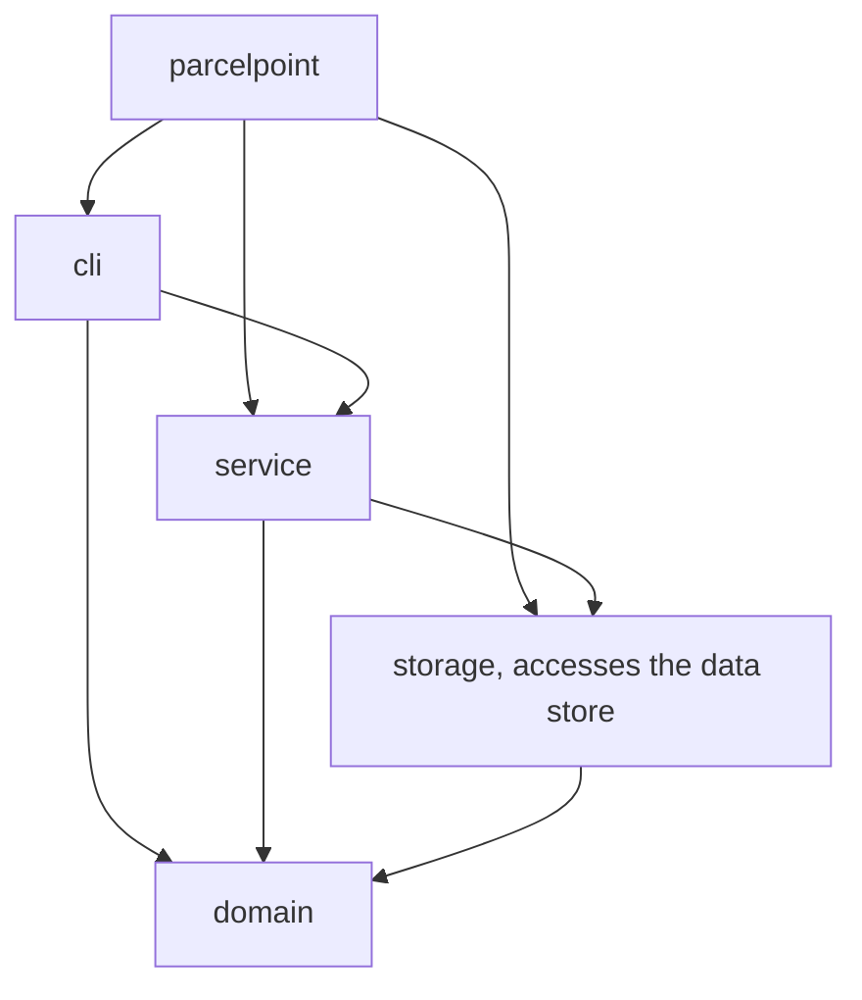
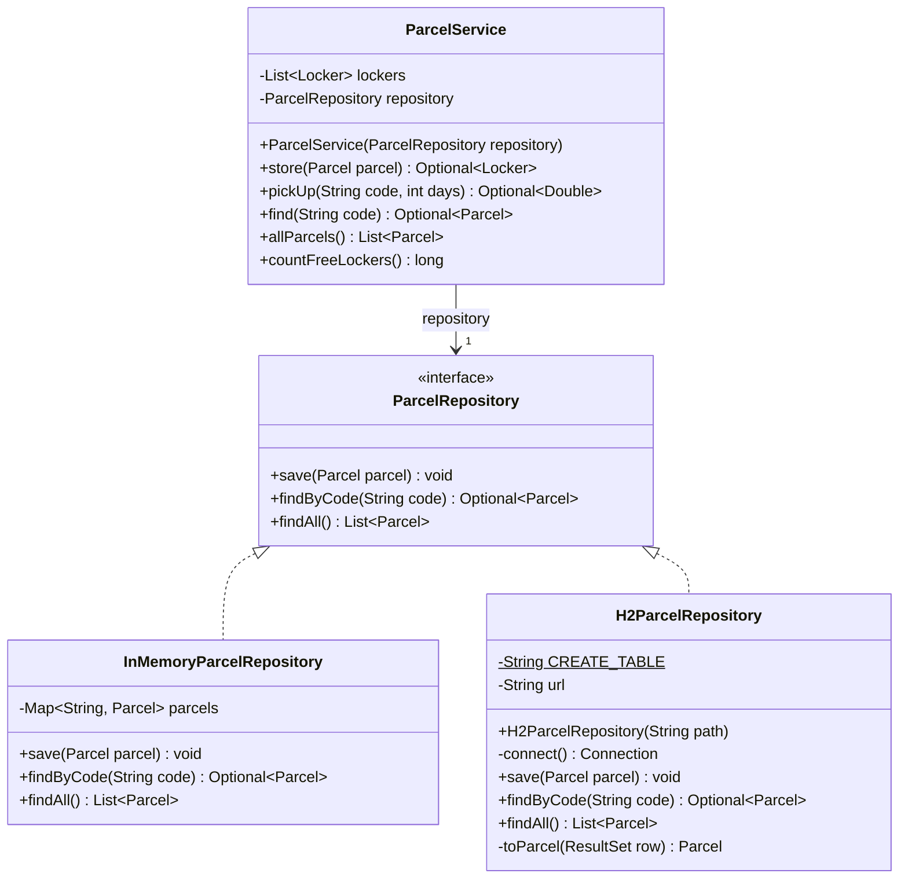
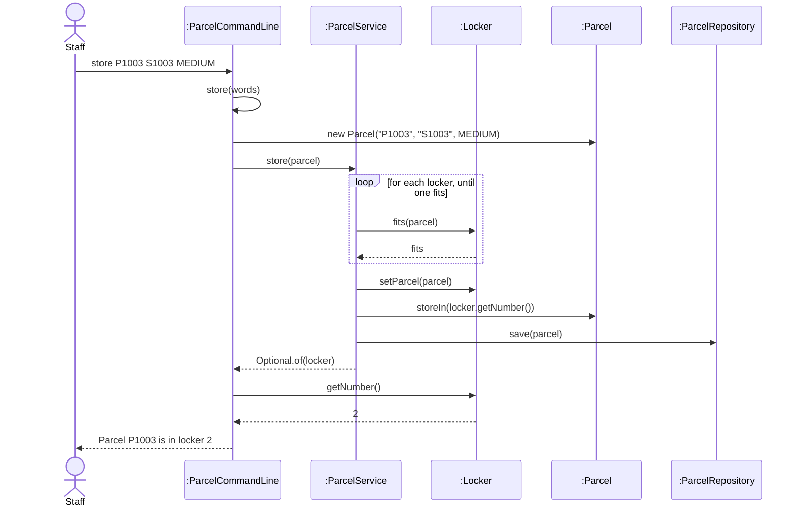

# Lab Report, Designing the Data Management Layer with H2

Repository URL: https://github.com/Touchchanont/itcs382-h2-lab.git

## Tools

| Item | Version or name |
| --- | --- |
| JDK | Eclipse Temurin OpenJDK 25.0.5 (25.0.5+8-LTS) |
| Maven | Apache Maven 3.10.0 |
| IDE | Visual Studio Code 1.146 with Extension Pack for Java |
| AI tool and exact model, if you used one | Claude Opus 5.5 (claude-opus-5-5), Anthropic |

## Part 0. From a store in memory to H2

Commit of the starter, before any change: ce420e0

0.3 Your prediction for `staff`, written before the second run:

`staff` will list no parcels and report `Free lockers: 3`, because nothing from the first run was written anywhere outside the program.

Output of the second run, for `staff` and `quit`:

```text
> staff
Free lockers: 3
> quit
```

State in one sentence where you think the parcels of the first run were kept.

They were kept only in the memory of the running program (a Java collection inside the repository object), so they disappeared when the JVM ended.

0.5 The line of Main that you would change to keep the parcels somewhere else:

```java
ParcelRepository repository = new InMemoryParcelRepository();
```

0.6 Commit of the switch to H2: 882220c

0.7 Output of `SELECT * FROM PARCEL;` after you stored two parcels:

```text
sql> SELECT * FROM PARCEL;
CODE  | STUDENT_ID | PARCEL_SIZE | STATUS | LOCKER_NUMBER
P1001 | S1001      | SMALL       | STORED | 1
P1002 | S1002      | LARGE       | STORED | 3
(2 rows, 16 ms)
```

0.8 Explain why ParcelPoint could not start while the H2 Shell was open, and identify the class that wrote the message `Cannot create the PARCEL table`.

H2 is an embedded database, so the process that opens `parcelpoint.mv.db` owns it and H2 locks the file. The H2 Shell still had the file open, so when ParcelPoint tried to connect, H2 refused with `JdbcSQLNonTransientConnectionException: Database may be already in use ... close all other connection(s); use the server mode [90020-252]`. The first line of the error was written by `H2ParcelRepository`: its constructor catches the `SQLException` thrown while running `CREATE TABLE IF NOT EXISTS` and rethrows it as an `IllegalStateException` with the message `Cannot create the PARCEL table`.

0.9 Explain why `staff` shows no parcel while `find` shows each one, and why all three lockers look free.

`find` calls `findByCode`, which really runs `SELECT * FROM PARCEL WHERE CODE = ?` on H2, so it finds each stored row. `staff` calls `allParcels()`, which calls `findAll`, and in the starter `findAll` was only a TODO stub that returned `List.of()` without touching the database, so the list was empty. The lockers look free because they are not stored in the database at all: the constructor of `ParcelService` rebuilds which locker holds which parcel by looping over `repository.findAll()`. With an empty list, no locker gets a parcel, so all three count as free. (In Step 0.6 it showed `Free lockers: 1` only because the parcels had been stored during that same run, so the in-memory lockers were already set.)

0.11 Your findAll method:

```java
@Override
public List<Parcel> findAll() {
    String sql = "SELECT * FROM PARCEL ORDER BY CODE";
    List<Parcel> parcels = new ArrayList<>();
    try (Connection connection = connect();
         PreparedStatement statement = connection.prepareStatement(sql)) {
        try (ResultSet row = statement.executeQuery()) {
            while (row.next()) {
                parcels.add(toParcel(row));
            }
        }
    } catch (SQLException e) {
        throw new IllegalStateException("Cannot read the parcels", e);
    }
    return parcels;
}
```

Commit that adds findAll: 195f75a

0.12 Output of `SELECT * FROM PARCEL;` after the pickup:

```text
sql> SELECT * FROM PARCEL;
CODE  | STUDENT_ID | PARCEL_SIZE | STATUS    | LOCKER_NUMBER
P1001 | S1001      | SMALL       | PICKED_UP | null
P1002 | S1002      | LARGE       | STORED    | 3
(2 rows, 14 ms)
```

0.13 Optional. Describe what `find P9999'OR'1'='1` showed while the SQL was joined from strings, and what it showed after you put the placeholder back.

With the SQL joined from strings, `find P9999` correctly said `No parcel with code P9999`, but `find P9999'OR'1'='1` printed `P1001, S1001, SMALL, PICKED_UP`, a parcel whose code was never typed. The quotes in the input closed the string literal and the query became `... WHERE CODE = 'P9999'OR'1'='1'`, and `'1'='1'` is true for every row (SQL injection). After restoring the `?` placeholder and `statement.setString(1, code)`, the same input printed `No parcel with code P9999'OR'1'='1`, because H2 compared `CODE` with the whole text as one value instead of treating it as SQL.

## Part A. Model the design

A1 Complete the flowchart with one node for each package and one arrow for each dependency, from the package that uses to the package that is used. Mark the package that accesses the data store.



State whether cli depends on storage, and explain why.

No. `ParcelCommandLine` imports only `parcelpoint.domain` and `parcelpoint.service`; it talks to `ParcelService` and works with `Parcel`, `Locker` and `ParcelSize` objects, and never names a repository. Only `ParcelService` (through the interface `ParcelRepository`) and `Main` (which creates the concrete repository) reach the storage package, so the user interface layer stays independent of the data store.

A2 Complete the class diagram of the data management layer with ParcelService, the interface ParcelRepository with its three operations, and the two classes that implement it.



A3 Draw a sequence diagram for the command `store P1003 S1003 MEDIUM`, from the staff member to the repository. Show each message as an operation of the class that receives it.



Explain why the last lifeline is the interface ParcelRepository rather than H2ParcelRepository.

`ParcelService` only knows its field `repository`, whose declared type is the interface `ParcelRepository`; its code never names `H2ParcelRepository`. A sequence diagram shows the messages as the sender sees them, so `save(parcel)` is sent to a `:ParcelRepository`. Which class actually receives it is decided at run time by `Main`, so the same diagram stays correct whether the program uses `InMemoryParcelRepository` or `H2ParcelRepository` (polymorphism, Dependency Inversion Principle).

## Part B. Design questions

1. Identify the files that you changed to move from the store in memory to H2, and explain why no other class had to change. Use the terms of this course.

To switch the store I changed only `Main.java` (the import and the line that creates the repository); I also completed `findAll` in `H2ParcelRepository.java`, which is inside the storage package. No other class changed because `ParcelService` depends on the abstraction `ParcelRepository`, not on a concrete class (Dependency Inversion Principle), and receives it through its constructor (dependency injection), so `Main` is the single place that decides which implementation is used. The interface hides how and where parcels are stored (information hiding), which keeps coupling between the business layer and the data management layer low, and lets a new store be added by writing a new class rather than modifying existing ones (Open/Closed Principle).

2. The PARCEL table stores the size of a parcel as SMALL, MEDIUM or LARGE rather than as 1, 2 or 3. Identify the type of connascence between ParcelSize and the table in each case, and explain which one is weaker.

Storing `SMALL`, `MEDIUM`, `LARGE` creates connascence of name: the table and `ParcelSize` only have to agree on the constant names, which `name()` writes and `ParcelSize.valueOf` reads back. Storing 1, 2 or 3 would create connascence of convention (both sides must agree that 1 means SMALL, and so on), and if the numbers came from `ordinal()` it would also be connascence of position, since the meaning would depend on the order in which the constants are declared. Connascence of name is weaker: the stored values are self-describing and readable in the H2 Shell, reordering or adding constants cannot silently change what old rows mean, and a renamed constant fails loudly in `valueOf` instead of quietly returning the wrong size.

3. Project Phase 2 asks for a data store that needs no separate server. Explain why an embedded database such as H2 meets this rule, and describe the limit of an embedded database that Step 0.8 showed.

H2 runs inside the program's own JVM as an ordinary library (one jar listed in `pom.xml`), and keeps its data in a local file (`data/parcelpoint.mv.db`) that it creates on the first connection; `CREATE TABLE IF NOT EXISTS` sets up the schema on first run, so nothing has to be installed, started or configured separately. The limit shown in Step 0.8 is that the database file belongs to the one process that opened it: H2 locks the file, so while the H2 Shell had it open, ParcelPoint could not connect (`Database may be already in use`). An embedded database therefore suits one program on one machine, not several programs or users sharing the data at the same time.

4. State the data store that you would choose for your Project Phase 2 team, files or an embedded database, the requirement that drives the choice, and the package that will access it.

I would choose an embedded database (H2). The driving requirement is that the system's records must survive after the program ends and must be looked up and updated by key (for example a record changing status, as a parcel does on pickup); a table with a primary key and `MERGE` handles this directly, while with files we would have to rewrite the whole file and write our own lookup and parsing code. H2 also satisfies the Phase 2 rules of no separate server and at most one external library. Only the `storage` package will access it, through a repository interface for each kind of object, and `Main` will create the H2 repositories.

## AI usage declaration

| AI tool and exact model | Date | Purpose | Files or answers it produced or changed | How you checked its output |
| --- | --- | --- | --- | --- |
| Claude Opus 5.5 (claude-opus-5-5), Anthropic | 2026-11-14 | Wrote `findAll` (Step 0.11), changed `Main` to use H2 (Step 0.6), and drafted the answers, diagrams and Part B in this report | `Main.java`, `H2ParcelRepository.java`, answers 0.3 to 0.13, A1 to A3, B1 to B4 | Compiled the code with `javac --release 17 -Xlint:all` (no errors or warnings); ran Steps 0.2 and 0.3 and compared the output with the lab sheet; checked each arrow in A1 against the import lines of every Java file and each message in A3 against `ParcelCommandLine.store` and `ParcelService.store`; built with `mvn package` on JDK 25, ran Steps 0.6 to 0.13 with the real H2 2.5.252 jar and the H2 Shell, and copied the actual outputs (0.7, 0.8 error, 0.11, 0.12, 0.13) into this report after comparing them with the lab sheet |
